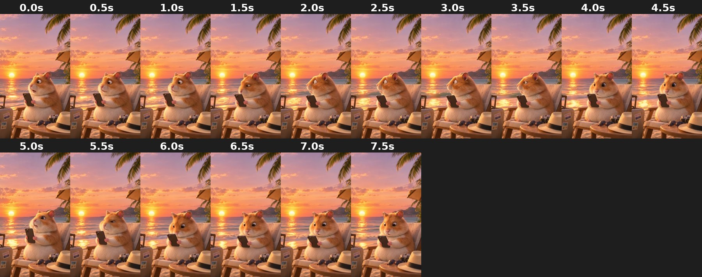

# beach_surprised

On a beach lounger at sunset, side-on, looking at the phone with surprised and nervous glances.

- **Background:** Beach at sunset with palm trees, suitcase, sun hat and camera. Built-in scene.
- **Framing:** Sitting, side/three-quarter view, upper body.
- **Branding:** None (plain hamster).
- **Cutout:** AI cutout is poor (see-through fur, eye hole). Keep the original scene.
- **Beat:** **4.0s** turns to face the camera, surprised. Clip is 7.9 s long.
- **Good for:** Vacation storage jokes: "Day 1 of vacation: iCloud Storage Full".
- **Audio:** Has an audio track.

| Time | Frame | What happens |
|---|---|---|
| 0.0s | `00.0s.jpg` | Side view, looking at phone, surprised. |
| 0.5s | `00.5s.jpg` | Side view, looking at phone. |
| 1.0s | `01.0s.jpg` | Side view, looking at phone. |
| 1.5s | `01.5s.jpg` | Profile, staring at phone. |
| 2.0s | `02.0s.jpg` | Profile, staring at phone, mouth slightly open. |
| 2.5s | `02.5s.jpg` | Profile, staring. |
| 3.0s | `03.0s.jpg` | Profile, staring. |
| 3.5s | `03.5s.jpg` | Turning slightly toward camera. |
| 4.0s | `04.0s.jpg` | **Three-quarter, wide eyes**, looking at camera. |
| 4.5s | `04.5s.jpg` | Three-quarter, looking at phone. |
| 5.0s | `05.0s.jpg` | Three-quarter, looking at phone, mouth open. |
| 5.5s | `05.5s.jpg` | Side-eye, nervous. |
| 6.0s | `06.0s.jpg` | Facing camera, wide eyes. |
| 6.5s | `06.5s.jpg` | Facing camera, looking at phone. |
| 7.0s | `07.0s.jpg` | Facing camera, wide eyes. |
| 7.5s | `07.5s.jpg` | Facing camera, staring. End. |
