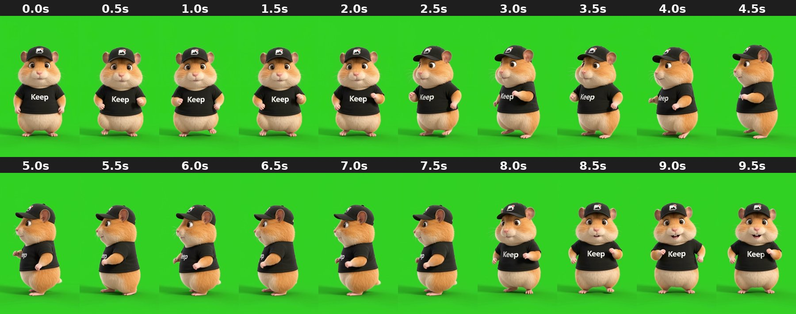

# green_strut-turn_fullbody

Confident little strut: faces camera, turns to its left and walks in profile, then turns back and grins.

- **Background:** Green screen (≈ RGB 50,207,35). Use "key": "green".
- **Framing:** Full body, centred, feet near the bottom (~y 1620 of 1920). No phone.
- **Branding:** Black cap with photo logo, black tee that says "Keep".
- **Cutout:** Exact green key, every frame. Best quality.
- **Beat:** 2.5s (turns into the strut); 8.0s (turns back to camera, smiles).
- **Good for:** "Me walking into…" overconfidence jokes; walking-in-a-place backgrounds (pier, airport, street).
- **Audio:** Has an audio track (strip with "mute": true if unwanted).

| Time | Frame | What happens |
|---|---|---|
| 0.0s | `00.0s.jpg` | Faces camera, standing still, neutral cute face, arms at sides. |
| 0.5s | `00.5s.jpg` | Same, small sway, arms lifting slightly. |
| 1.0s | `01.0s.jpg` | Little bounce on the spot, fists up like a mini dance. |
| 1.5s | `01.5s.jpg` | Bouncing, fists at chest height, looking at camera. |
| 2.0s | `02.0s.jpg` | Starts turning to its left (screen left). |
| 2.5s | `02.5s.jpg` | Three-quarter view, mid-turn, one arm forward. **Strut starts.** |
| 3.0s | `03.0s.jpg` | Three-quarter, stepping forward, confident. |
| 3.5s | `03.5s.jpg` | Three-quarter, walking, arm swinging. |
| 4.0s | `04.0s.jpg` | Turning further into profile. |
| 4.5s | `04.5s.jpg` | Profile facing screen left, walking. |
| 5.0s | `05.0s.jpg` | Profile, walking, looking ahead. |
| 5.5s | `05.5s.jpg` | Profile, mid-step. |
| 6.0s | `06.0s.jpg` | Profile, mid-step, arm forward. |
| 6.5s | `06.5s.jpg` | Profile, mid-step. |
| 7.0s | `07.0s.jpg` | Profile, starting to turn back. |
| 7.5s | `07.5s.jpg` | Three-quarter, turning back toward camera. |
| 8.0s | `08.0s.jpg` | Faces camera again, arms out. **Turns back.** |
| 8.5s | `08.5s.jpg` | Faces camera, small smile. |
| 9.0s | `09.0s.jpg` | Faces camera, open happy grin, fists up. |
| 9.5s | `09.5s.jpg` | Faces camera, grinning, little dance pose. End. |
