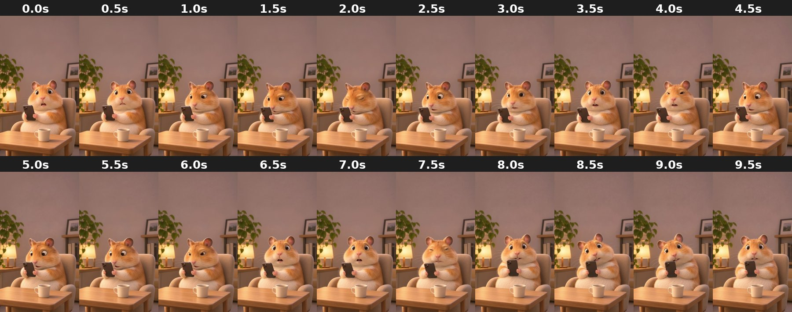

# living-room_sleepy-to-shocked

In an armchair at night with a mug, drifting between sleepy and wide-eyed while looking at the phone.

- **Background:** Cozy living room at night (lamp, plant, mug). Built-in scene.
- **Framing:** Sitting, upper body above a coffee table.
- **Branding:** None (plain hamster, no cap or tee).
- **Cutout:** AI cutout is poor: fur blends with the warm background. Keep the original scene.
- **Beat:** **2.0s** eyes closed (sleepy). **3.0s** and **6.5s** wide-eyed shock. **7.5s** winces.
- **Good for:** Late-night scrolling jokes: "2am, checking iPhone Storage…".
- **Audio:** Has an audio track.

| Time | Frame | What happens |
|---|---|---|
| 0.0s | `00.0s.jpg` | Wide-eyed, mouth open, looking at camera. |
| 0.5s | `00.5s.jpg` | Wide-eyed, looking at camera. |
| 1.0s | `01.0s.jpg` | Looks down at phone, side-eye. |
| 1.5s | `01.5s.jpg` | Sleepy, squinting at the phone. |
| 2.0s | `02.0s.jpg` | **Eyes closed**, dozing. |
| 2.5s | `02.5s.jpg` | Waking up, side-eye at the phone. |
| 3.0s | `03.0s.jpg` | **Wide-eyed**, looking at camera. |
| 3.5s | `03.5s.jpg` | Wide-eyed, mouth open. |
| 4.0s | `04.0s.jpg` | Squinting, one eye half closed. |
| 4.5s | `04.5s.jpg` | Side-eye at the phone. |
| 5.0s | `05.0s.jpg` | Looking at phone, side-eye. |
| 5.5s | `05.5s.jpg` | Looking at phone, sleepy. |
| 6.0s | `06.0s.jpg` | Squinting at the phone. |
| 6.5s | `06.5s.jpg` | **Wide-eyed shock**, mouth open, looking at camera. |
| 7.0s | `07.0s.jpg` | Shocked, mouth open. |
| 7.5s | `07.5s.jpg` | Winces, eyes squeezed. |
| 8.0s | `08.0s.jpg` | Wide-eyed, phone close to face. |
| 8.5s | `08.5s.jpg` | Wide-eyed, nervous. |
| 9.0s | `09.0s.jpg` | Wide-eyed, phone at face. |
| 9.5s | `09.5s.jpg` | Wide-eyed, looking at camera. End. |
