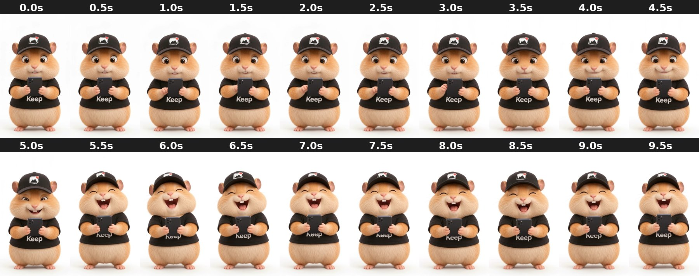

# white_calm-to-laughing_fullbody

Holds phone calmly smiling, then bursts out laughing at 5.5s and keeps laughing.

- **Background:** Plain white studio. AI cutout needed for new backgrounds.
- **Framing:** Full body, centred, feet near ~y 1720. Holds phone in both hands at chest.
- **Branding:** Black cap with photo logo, black tee that says "Keep".
- **Cutout:** AI cutout works well (slow movement).
- **Beat:** **5.5s**: eyes close and it laughs out loud. Put the punchline at 5.0–5.5s.
- **Good for:** Bad-photo jokes: "37 photos of his thumb 😭", "I'm blinking in all of them".
- **Audio:** Has an audio track.

| Time | Frame | What happens |
|---|---|---|
| 0.0s | `00.0s.jpg` | Looking at phone, slight smile, eyes open. |
| 0.5s | `00.5s.jpg` | Looking at phone, smiling. |
| 1.0s | `01.0s.jpg` | Looking at phone, scrolling. |
| 1.5s | `01.5s.jpg` | Looking at phone, scrolling, small smile. |
| 2.0s | `02.0s.jpg` | Looking at phone, amused smile. |
| 2.5s | `02.5s.jpg` | Looking at phone, smile widening. |
| 3.0s | `03.0s.jpg` | Glances up, amused. |
| 3.5s | `03.5s.jpg` | Smiling, cheeks puffing, holding back a laugh. |
| 4.0s | `04.0s.jpg` | Squinting smile, holding back a laugh. |
| 4.5s | `04.5s.jpg` | Squinting, grinning. |
| 5.0s | `05.0s.jpg` | Eyes squeezed, starting to laugh. |
| 5.5s | `05.5s.jpg` | **Bursts out laughing**, mouth wide open, eyes shut. |
| 6.0s | `06.0s.jpg` | Laughing hard, mouth open. |
| 6.5s | `06.5s.jpg` | Laughing, teeth showing. |
| 7.0s | `07.0s.jpg` | Laughing, head tilted back slightly. |
| 7.5s | `07.5s.jpg` | Laughing. |
| 8.0s | `08.0s.jpg` | Laughing, mouth wide. |
| 8.5s | `08.5s.jpg` | Laughing. |
| 9.0s | `09.0s.jpg` | Laughing, eyes shut. |
| 9.5s | `09.5s.jpg` | Still laughing. End. |
