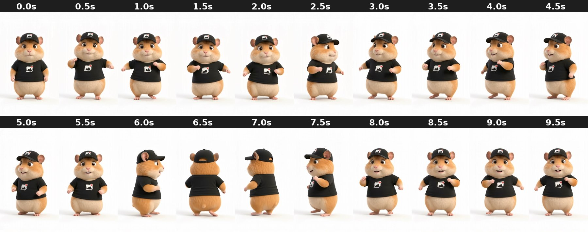

# white_dance_fullbody

Happy dance: bops in place, turns around (back to camera at 6.5s) and comes back grinning.

- **Background:** Plain off-white studio (RGB ~251,251,251). No green; AI cutout needed for new backgrounds (fast moves can ghost at the edges).
- **Framing:** Full body, centred, feet near ~y 1720. No phone.
- **Branding:** Black cap and tee with the photo-and-heart logo.
- **Cutout:** AI cutout works, but arms and the spin can show edge flicker.
- **Beat:** Whole clip is a celebration; the spin at 6.0–7.5s is the most dynamic moment.
- **Good for:** Payoff and celebration reels: "Me after deleting 4,000 screenshots".
- **Audio:** Has an audio track.

| Time | Frame | What happens |
|---|---|---|
| 0.0s | `00.0s.jpg` | Faces camera, standing, soft smile, arms down. |
| 0.5s | `00.5s.jpg` | Starts dancing, arms out, bouncing. |
| 1.0s | `01.0s.jpg` | Dancing, fists out to the sides. |
| 1.5s | `01.5s.jpg` | Dancing, arms swinging, smiling. |
| 2.0s | `02.0s.jpg` | Dancing, leaning, arms out. |
| 2.5s | `02.5s.jpg` | Turning slightly to its left, three-quarter. |
| 3.0s | `03.0s.jpg` | Three-quarter, dancing, looking at camera. |
| 3.5s | `03.5s.jpg` | Three-quarter the other way, arms swinging. |
| 4.0s | `04.0s.jpg` | Three-quarter, little hop, cheeky smile. |
| 4.5s | `04.5s.jpg` | Three-quarter, smiling, arm forward. |
| 5.0s | `05.0s.jpg` | Three-quarter, smiling, dancing. |
| 5.5s | `05.5s.jpg` | Faces camera, smiling, arms in. |
| 6.0s | `06.0s.jpg` | Starts spinning, side view. |
| 6.5s | `06.5s.jpg` | **Back to camera**, mid-spin. |
| 7.0s | `07.0s.jpg` | Side view, finishing spin. |
| 7.5s | `07.5s.jpg` | Three-quarter, coming back round, smiling. |
| 8.0s | `08.0s.jpg` | Faces camera, big grin showing teeth, arms out. |
| 8.5s | `08.5s.jpg` | Faces camera, grinning, dancing. |
| 9.0s | `09.0s.jpg` | Faces camera, grinning, fists up. |
| 9.5s | `09.5s.jpg` | Faces camera, grinning. End. |
